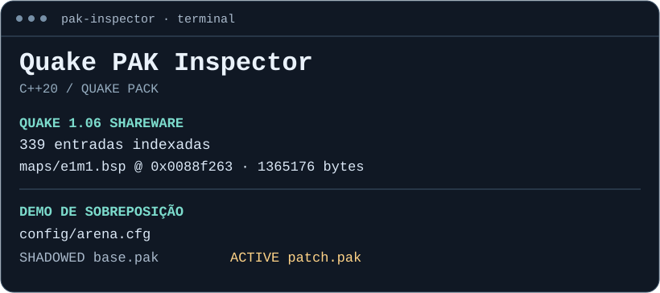

# Quake PAK Inspector

Ferramenta em **C++20** para inspecionar os pacotes do Quake clássico. Localize um mapa no binário, descubra o que mudou entre duas versões e identifique qual pacote fornece um recurso quando um mod sobrescreve o original.

[Baixar demo para Windows](https://github.com/brunoo-code/quake-pak-inspector/releases/latest) · [Validação com Quake 1.06](#validação-com-quake-106) · [Formato binário](#como-o-formato-foi-identificado)



| Comando | O que revela |
| --- | --- |
| `list` | Caminho interno, offset absoluto e tamanho de cada recurso |
| `inspect` | Até 128 bytes em hexadecimal e ASCII, com offsets do arquivo |
| `diff` | Recursos adicionados, removidos ou alterados, comparados byte a byte |
| `overlay` | Qual pacote fornece um recurso quando vários têm o mesmo caminho |

## Demo

No Windows, extraia o ZIP da release e abra `Abrir demo.cmd`. A sequência lista as entradas, mostra um hexdump, compara dois pacotes e demonstra a ordem de carregamento.

No pacote original, `config/arena.cfg` define dez minutos. O patch traz a mesma entrada com quinze. Mesmo com o mesmo tamanho, a mudança aparece no diff. O relatório de sobreposição explica por que o patch prevalece.

```text
> pak-inspector diff examples/base.pak examples/repacked.pak
CHANGED    config/arena.cfg
REMOVED    docs/old.txt
ADDED      docs/changelog.txt

> pak-inspector overlay config/arena.cfg examples/base.pak examples/patch.pak
SHADOWED   examples/base.pak
ACTIVE     examples/patch.pak
```

Os três arquivos de exemplo contêm texto criado para a demo. Recrie-os com `python tools/make_demo.py`. Você também pode passar o caminho de um PAK clássico que já tenha instalado.

## Validação com Quake 1.06

O teste de integração leu o `ID1/PAK0.PAK` da [edição shareware 1.06, preservada no espelho da GWDG](https://ftp.gwdg.de/pub/misc/ftp.idsoftware.com/idstuff/quake/). A amostra tem **18.689.235 bytes** e **339 entradas**. Uma segunda leitura, feita com `struct` do Python, confirmou os nomes, offsets e tamanhos de todas as entradas. O teste também conferiu os primeiros 128 bytes de `maps/e1m1.bsp` e executou um diff do pacote com ele mesmo.

| Recurso | Offset absoluto | Bytes |
| --- | ---: | ---: |
| `gfx/palette.lmp` | 6.832.530 | 768 |
| `maps/e1m1.bsp` | 8.974.947 | 1.365.176 |
| `progs.dat` | 18.276.119 | 413.116 |

O diretório começa em **18.254.423**, ocupa **21.696 bytes** e termina antes de `progs.dat`. A amostra real demonstra por que o leitor usa o offset de cada entrada em vez de presumir que todos os recursos ficam antes do diretório.

Para repetir a validação, obtenha o `PAK0.PAK` do `resource.1` dentro de `quake106.zip`. O teste confirma o SHA-256 antes de comparar os dados. A demo pública usa pacotes próprios e a tabela acima registra os resultados do teste real.

```powershell
python tests/shareware.py .\build\Release\pak-inspector.exe caminho\ID1\PAK0.PAK
```

## Como o formato foi identificado

A referência é [`COM_LoadPackFile`, no código original publicado pela id Software](https://github.com/id-Software/Quake/blob/bf4ac424ce754894ac8f1dae6a3981954bc9852d/WinQuake/common.c#L1543-L1588). O carregador verifica a assinatura, converte campos little-endian e procura uma tabela de entradas de tamanho fixo. O programa implementa essa leitura em C++ com deslocamentos explícitos.

| Estrutura | Posição | Tamanho | Conteúdo |
| --- | ---: | ---: | --- |
| Cabeçalho | 0 | 4 | ASCII `PACK` |
| Cabeçalho | 4 | 4 | Offset absoluto do diretório |
| Cabeçalho | 8 | 4 | Tamanho do diretório em bytes |
| Entrada | +0 | 56 | Caminho terminado em NUL |
| Entrada | +56 | 4 | Offset absoluto do recurso |
| Entrada | +60 | 4 | Tamanho do recurso |

No `base.pak` da demo, a entrada de configuração começa no byte 12. Os primeiros 12 bytes do arquivo são `50 41 43 4b 53 00 00 00 c0 00 00 00`. O diretório começa em `0x53` e ocupa `0xc0` bytes, o equivalente a três registros de 64 bytes.

[`COM_AddGameDirectory`](https://github.com/id-Software/Quake/blob/bf4ac424ce754894ac8f1dae6a3981954bc9852d/WinQuake/common.c#L1623-L1636) insere os PAKs numerados mais altos na frente da lista de busca. A demo reproduz essa precedência entre os pacotes fornecidos, na ordem base → patch. O comando usa nomes exatos e representa apenas as camadas PAK informadas. Arquivos soltos e a lógica completa de busca do motor ficam fora desse modelo.

## Compilação e testes

Use CMake 3.20+, um compilador C++20 e Python 3.10+ para rodar os testes e recriar os exemplos.

```powershell
cmake -S . -B build
cmake --build build --config Release
ctest --test-dir build -C Release --output-on-failure
.\build\Release\pak-inspector.exe inspect examples/base.pak config/arena.cfg
```

Com Ninja ou Make, o executável normalmente fica direto em `build/`. Os testes verificam a CLI com arquivos de exemplo, alterações de mesmo tamanho, entradas deslocadas, precedência entre pacotes e diretórios inválidos.

O leitor limita a tabela a 65.536 registros, aceita caminhos ASCII e rejeita nomes repetidos, intervalos fora do arquivo e recursos que invadem o cabeçalho ou diretório. O diff lê o conteúdo em blocos de 64 KiB. Esta versão cobre o formato `PACK` clássico.
